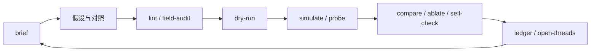

把 agent 接进一个项目，最常见的做法是给它一个 shell、一份 README，然后希望它自己看懂。演示里这没问题。连续跑几十轮之后，问题会集中出现：它每一轮都在重新猜参数，解析人类看的日志，在自然语言报错里找原因；一次重构，之前记住的调用方式全部作废。

[WorldQuantUser](https://github.com/SwufeFox/WorldQuantUser) 是一个面向 WorldQuant BRAIN 的 alpha 研究工具：生成 FASTEXPR、批量模拟、读回结果。它反过来做。它不要求 agent 读源码，而是要求每个工具都能用一个 JSON 文档说明自己做了什么、为什么失败、下一步可以做什么。README 把这条约束写成一句话：**a program should be able to drive the whole loop without reading the source.** 这就是本文说的 agent over tools：agent 在工具之上做决策，工具在 agent 之下提供稳定语义；两者之间不是「使用关系」，而是一份协议。

## 一次调用，一个 JSON 文档

Agent 最怕的不是报错，而是「看起来像成功」。所以这个 CLI 的第一条契约是：stdout 恰好一个 JSON 文档，成功和失败都一样；进度写 stderr，永远不会污染结果。

```python
import json
import subprocess

def call(*args):
    proc = subprocess.run(
        ["python", "research_cli.py", *args],
        capture_output=True,
        text=True,
    )
    result = json.loads(proc.stdout)
    if not result["ok"]:
        error = result["error"]
        raise RuntimeError(f'{error["code"]}: {error["message"]}')
    return result
```

这段代码的重点不是短，而是它不需要理解任何一条错误文案。失败信封里有稳定的 `error.code`、给调用方的 `hint`，以及可选的 `error.details`；比如 lint 失败时，`details` 会按表达式列出每一条发现，调用方不用去正则解析 message。

进程退出码也承担语义：`2` 是输入错误，`3` 是认证，`4` 是服务或限流，`5` 是找不到，`6` 是所有模拟都失败，`7` 是提交被策略锁拒绝，`130` 是中断。`7` 单独存在，是为了让调用方分清「策略说不行」和「服务坏了」：前者应该停止追问，后者可以重试。

还有两个细节，都是为自动化准备的：

- 没有交互式提示。认证失败直接抛 `MissingCredentials`、`AuthError` 或 `CaptchaRequired`。对自动调用方来说，一个等待输入的程序不是慢请求，是挂死。
- `--save PATH` 原子写入与 stdout 完全相同的 JSON envelope，失败也写。`--stream` 把进度事件以 JSON Lines 发到 stderr，stdout 仍然只有一个文档。这样长任务可以边跑边观察，而不破坏契约。

## 工具自己描述自己

Agent 不应该靠读 `research_cli.py` 来学习接口。这个仓库把帮助和 schema 都从实际参数声明生成，命令绑定和文档是同一份来源，不会出现「文档写着 `--foo`，代码里已经改成 `--bar`」的第二套真相。

```bash
python research_cli.py help                    # 命令地图，不熟的时候才读
python research_cli.py help catalog fields     # 一个任务的参数和例子
python research_cli.py schema probe            # 一个命令的机器契约
```

这里有一个刻意的分层：`schema` 全量输出是给工具集成用的，不是每轮启动的必读项；`help` 也只在不知道下一步用什么命令时打开。Agent 的上下文是预算，不是免费内存。仓库甚至在 `AGENTS.md` 里写明：不要为了了解接口去读入口源码；按当前阶段取最少的信息。

| 阶段 | 需要的信息 | 入口 |
| --- | --- | --- |
| 启动 | 当前状态、证据摘要、来源路径 | `brief` |
| 发现 | 这一步有哪些命令 | `help` |
| 执行 | 参数、默认值、示例 | `help <command>` |
| 集成 | 稳定的机器契约 | `schema <command>` |
| 恢复 | 上次跑到哪、哪些任务已接受 | `resume <checkpoint>` |

工具数量本身也是上下文成本。仓库删掉了被取代的宏子系统、一次性迁移脚本和重复入口，只保留还会被问第二次的东西；新增入口前必须先回答：最接近的现成工具是哪个，为什么不能扩一个参数或子命令。对 agent 来说，入口越少，契约越清晰，误选也越少。

`brief` 是这套信息路由里最重要的一个。它把当前研究状态压成一份有界的文档：最近的高分线索、受挫记录、未决问题、台账路径，以及哪些文件存在但为空。它还会把长文本预览截到 240 字符，明确告诉你「这是预览，结论要回源文件读」。这比让 agent 每轮 grep 整个研究目录便宜得多，也诚实得多。

## 快，是因为失败便宜

「快速迭代」通常被理解成执行快。真正决定循环速度的是另一件事：**一次失败要花多少代价**。模拟额度、网络等待、被限流后的重试、跑到一半超时，这些都比模型生成慢得多。

WorldQuantUser 把大部分失败挡在昂贵动作之前：

| 失败 | 在哪里暴露 | 代价 |
| --- | --- | --- |
| 字段名写错 | `catalog verify`、`simulate` 预检 | 0 次模拟 |
| 量纲不一致 | `lint`、`field-audit` | 0 次模拟 |
| 请求形状错误 | `--dry-run` | 0 次模拟，不需要凭据 |
| 跑到一半超时 | checkpoint / `resume` | 不重复已接受的模拟 |
| 重复一个已否定的方向 | `ledger list`、`brief` | 0 次模拟 |
| 目录元数据重复拉取 | 带 TTL 的 metadata cache | 0 次请求 |

`probe --dry-run` 是这条原则的极端版本：它不加载会话、不读凭据、不联系目录服务、不花额度，却会校验每一个设置组，解析默认值和每条臂的 decay，返回完整的 `POST /simulations` payload。也就是说，最便宜的一步已经能回答「这批请求长什么样」。确认之后，真正的 `probe` 还会在登录和提交前再做一次本地校验，并用同一份目录检查拦住未知字段名。

这不是纸上谈兵。仓库里有一个很具体的教训：`cap + abs(liabilities)` 被模拟器拒绝，因为市值带着 `Unit[CSPrice:1,CSShare:1]`，而负债在目录里是无量纲的；同一个错误形状还出现在同批的三条表达式里。现在 `lint` 会先给出 `unit_mismatch`，并说明「除一个共同尺度，不要相加」。更底层的一步是 `probe_units`：它不猜单位，而是把字段和纯数字相加，从模拟器自己的拒绝信息里读回单位，再把答案缓存起来。下一次，这个问题不再花一次模拟。

超时也一样。模拟命令默认有 5 分钟的墙钟预算；如果服务器的 `Retry-After` 会超过预算，它返回 `PENDING`，而不是睡过四小时的会话缓存寿命。已接受的任务和未提交的表达式会原子写入 checkpoint，`resume` 先轮询已接受的任务，再提交队列里的工作，所以恢复不会重复提交。对 agent 来说，这意味着「失败」通常是一个可继续的状态，而不是一轮工作的终点。

## 记忆不能留在对话里

Agent 的上下文会结束，研究不会。把结论留在聊天记录里，下一轮就要重新读一遍；把结论写进源码旁边的注释，又会把研究数据混进版本历史。这个仓库把两者分开：代码在 git 里，结果、缓存、一次性脚本和台账在研究目录里；仓库内的 `research/` 被 git 忽略，作为一道护栏。

台账是 append-only 的 JSONL，一条 alpha 一行，包含表达式、完整设置、训练期指标、平台检查、所属想法、verdict 和 note。它可以离线查询：

```bash
python research_cli.py ledger list --field anl4_cfo_number
python research_cli.py ledger list --mechanism revision --verdict rejected
```

`already_tested: true` 不是一句「别试了」，而是「先读这个字段之前的 verdict 和指标」。verdict 也不是一组失败状态：`rejected` 表示表达式在这些设置下不合格；`falsified` 表示一个有对照的假设被检验并否定；`no_go` 表示还没得到公平检验就被数据或执行条件挡住。把 `falsified` 和 `rejected` 分开，是为了让后来的轮次知道「这个机制已经被排除」，而不是「这个写法分数不高」。

跨会话的当前问题放在 `open-threads.md`，一行一个：`- [open] **问题** — 证据；下一个能区分解释的检查`。每轮只更新受证据影响的那一行，详细的推导留在链接的记录里。用 `AGENTS.md` 的话说，交接的是决定，不是对话。

## 闭环

把上面的东西接起来，一轮迭代就是一条很短的链：



对应的命令序列也不复杂：

```bash
python research_cli.py brief
python research_cli.py probe spec.json --dry-run
python research_cli.py probe spec.json
python research_cli.py compare results.json --contributions
python research_cli.py ledger record P0Mq0wEM \
  --idea "leverage, size-bucketed" \
  --verdict candidate \
  --note "why it mattered"
python research_cli.py brief
```

每一步都只依赖上一步的 JSON 和当前命令的 schema，不依赖某个隐藏的会话状态。`brief` 重新打开时，agent 拿到的是证据和来源路径，不是上一轮的聊天记录。这就是「全自动」能持续的原因：循环的输入输出都在磁盘上，而不是在上下文窗口里。

## 全自动不等于无边界

这套东西里最值得抄的，可能不是 JSON，而是对「自动」的克制。

提交是唯一不可逆的平台动作，所以它默认是 dry-run：`alpha submit ID` 只跑实时检查，什么都不发；只有 `--yes` 才真的写。仓库还要求 `.env` 或环境里恰好有 `ALLOW_AGENT_SUBMIT=true`，其他写法——`1`、`yes`、`TRUE`、`on`——一律视为关闭。空格可以原谅，语义模糊不行；模糊就解析成「不」。

提交结果也不是布尔值。`submitted` 只在 `CONFIRMED` 时为真，另外几种状态必须区别对待：

| `submission` | 含义 |
| --- | --- |
| `CONFIRMED` | `dateSubmitted` 已写入，真的进了书 |
| `ACCEPTED` | 平台收下了请求，但还不能算提交，要回读 |
| `REJECTED` | 被拒，`failed_checks` 指出是哪一项、值是多少 |
| `UNCERTAIN` | 回读失败，结果未知 |
| `NOT_SENT` | 预检，什么都没写 |

这不是过度设计。仓库里有过一个版本，把 HTTP 状态小于 400 当成提交成功，结果报告了二十条「已提交」，实际上它们仍是 `UNSUBMITTED`。对自动系统来说，一个乐观的布尔值比一个明确的 `UNCERTAIN` 危险得多。

实验设计也有边界。`probe` 的受控批次必须恰好有一个 `control`；没有对照的批次要在 spec 顶层显式声明 `design: "explore"`。这不是为了好看，而是为了归因：一批没有合格对照的减法实验，只能看到「更差」，看不出差在哪里。扫描和实验在台账里长得一样，唯一区别是扫描自己承认了。

最后，`lint` 不是正确性证明。它能查未知算子、参数个数、字段名和量纲，但查不出一个语法正确、经济上毫无意义的表达式。自动化的价值不是把判断删掉，而是把判断变成可执行的拒绝，让人只需要看不被拒绝的那一小部分。

## 把 Agent 放在工具之上

Agent over tools 不是「给 agent 更多工具」，也不是「让 agent 学会读源码」。它更像一条接口纪律：

- 工具要能自己说明接口，而不是要求调用方理解实现；
- 每次调用要返回一个可解析的结果，失败要有稳定的分类；
- 昂贵动作之前要有便宜的预检，失败要能恢复；
- 结论要写进持久存储，而不是留在对话里；
- 不可逆的动作要有明确的锁和可区分的结果。

做到这些，agent 才能在一轮又一轮之间保持同一个循环，而不是每次重新学习项目。模型可以换，提示可以改，工具的实现可以重构；只要契约还在，循环就还在。

WorldQuantUser 的 README 把目标写得很平：让程序不读源码也能驱动整个循环。这句话也可以当成对任何「agent 工具」的验收标准。如果一个新的进程做不到这一点，那它就不是 agent 的工具，只是一个给人用的脚本，外面套了一层 agent。

下一次迭代，从 `brief` 开始，而不是从打开源码开始。

— Magixyne，2026-11-13
