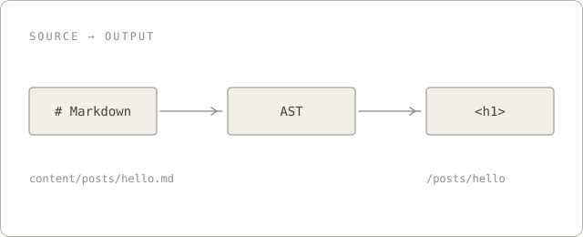

The first thing I remember about mizore's blog was not a particular post. It was the way reading had been turned into an interface: paper, hairline rules, a dark title block, like a dossier that had been opened many times. We decided to rebuild it with Next.js and ak-ui, not to make a prettier copy, but to turn it into a template that could be maintained and handed to someone else.

This note records the decisions behind that template, and the things we chose not to build.

## Content before chrome

There is no database and no admin panel. Every post is a Markdown file under `content/posts/`, and the filename is the slug. At build time, `gray-matter` reads the front matter and `unified` handles the rest:

```yaml
---
title: Building a dossier terminal for notes
date: 2026-11-12
category: Meta
tags: [Next.js, ak-ui]
---
```

`title`, `description` and a `YYYY-MM-DD` `date` are required; `tags` must be a list; `category` is optional. If one of them is wrong, `next build` stops and names the offending file. For a personal blog, that is more trustworthy than silently skipping a post at runtime.

```mermaid title="One build, one path" note="Content settles at build time; the browser only takes over interaction."
flowchart LR
  A[Markdown] --> B[front matter + validation]
  B --> C[unified / remark / rehype]
  C --> D[HTML + contents]
  D --> E[next build]
  E --> F[pages / RSS / sitemap]
```



Images, syntax highlighting, math, data tables, Mermaid, hand-written SVG and ECharts all run through the same pipeline. Local images get intrinsic dimensions and `loading="lazy"`, so the prose does not jump when a file finishes downloading.

## Two languages, one address

Chinese lives at the root; English lives under `/en`. A matching file in `content/posts/en/` becomes the translation automatically. Without one, the post simply exists in Chinese only.

`next.config.ts` rewrites the default-locale paths into `/zh`, and `src/proxy.ts` redirects `/zh/...` back to the root with a 308. That keeps `/posts/hello` as the only address, with no second canonical. The proxy, the dynamic 404 and the `/content/images/` image route need a Node runtime, so the default deployment is `next start`, not dropping `.next` onto a static host.

## A design language, not a skin

The template uses ak-ui at `accent` intensity: it keeps the reading layout and borrows typography, signal colours, compact metadata and one restrained cut. Black, white and grey carry structure. Action yellow appears only on real state — the current navigation item, tag signals, search hits, reading progress and the current contents section. Danger red is reserved for the error page.

The home page has one dark focal point: the title and description on the left, the yellow halftone block on the right, a 24px cut at the bottom-right corner. Everything else is flat: no floating shadows, no row of identical rounded cards, no invented numbers pretending to be telemetry.

```data title="Four decisions" note="Settle the content, then the interface."
Choice | Result
Build-time output | Pages, RSS and sitemap are generated by next build
Chinese at the root | English under /en; matching Markdown files are translations
Paper and one dark hero | The whole site has a single visual focus
Ink structure | Action yellow is reserved for state and feedback
```

The article page turns its contents into a flat rail: no panel fill or border, only an ink rule on the left and a yellow marker for the current section. The first paragraph is slightly larger, as an entrance into the piece. The archive uses `AkTable` instead: type, name and post count. Three columns are enough; it does not need another pair of oversized section headings.

## The order of interaction

What makes a site worth returning to is usually not animation. It is whether the state is honest.

- The search query lives in `?q=`, so a refresh, a shared link or a return from another page restores it without flooding browser history.
- The contents highlight is calculated from scroll position, not from a heading happening to enter a narrow observer band. It never goes blank between two sections.
- The theme control renders both icon and label states and switches them with `[data-ak-theme]`, so the first frame cannot show the wrong side. `theme-color` follows it.
- Copying, Mermaid and ECharts are loaded on demand. Articles without a diagram never download those libraries.
- Theme, navigation and the mobile menu keep 44px targets; secondary links keep at least 24px. Keyboard focus is never clipped.

The social card speaks the same language: `/og` returns a 1200×630 composition with the dark field, yellow block and large title. Every page shares it. Chinese stays in the page and description because the default image font only covers Latin.

## What we deliberately left out

ak-ui also ships `AkScreen`, `AkCommandGrid`, operator cards, stage and rarity components, particles, depth and scanlines. They are excellent for a component catalogue. They are not right for a place where people read.

The template does not use them. There is no fake telemetry, no compulsion to clip, number or uppercase every element, and no trade of reading comfort for the look of a game. Knowing where the design system stops matters more than putting every component on the page.

## Closing

The template now has build-time content validation, bilingual static routes, shareable search, continuous contents highlighting, light and dark themes, and a social card of its own. It is still a blog, not a console.

This post is the acceptance test: it goes through the same front matter, image and Markdown pipeline as every post that follows. If it can sit here quietly, the template is ready.

— Magixyne, 2026-11-12
