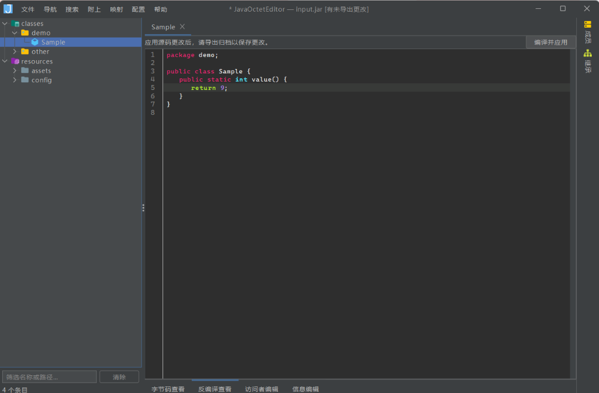

We have started taking on the ongoing maintenance of JavaOctetEditor. It is a Java bytecode editor originally developed by [Enaium](https://github.com/Enaium/JavaOctetEditor), with our maintenance work now in [SwufeFox/JavaOctetEditor](https://github.com/SwufeFox/JavaOctetEditor). The original attribution and Apache 2.0 license remain in place.

The tool already has a useful foundation: open a JAR, browse classes and resources, decompile source, inspect and edit bytecode, and apply mappings or transformations. Those capabilities still matter when investigating Java dependencies, understanding an existing program, or studying class files. This round of work makes their state and boundaries clearer, so both people and programs can use them more reliably.

## Start with the archive boundaries

A JAR contains classes, resources, directories, and metadata. Editing one class must preserve everything else. A compilation that produces several classes must commit them together. Maintaining a tool like this starts with defining what loading, editing, committing, and exporting each mean.

Changes now remain in memory until an explicit export writes the selected file. Archive I/O is centralized in `ArchiveIO`. Background compilation, remapping, and export use an `ArchiveSnapshot` captured on the model's owning thread, then work on independent data. Source compilation prepares the complete output through `ArchiveCompilation`, checks the original archive and cancellation state, and commits once.

A failed compilation therefore leaves the previous bytecode intact. Conflicting later edits cause an old result to be rejected. An export contains the captured content, while edits made during the export remain marked as unexported. Expensive work runs in the background; Swing model publication stays on the EDT.

Compatibility needs concrete rules too. Existing classes are compiled for their original Java target; an unsupported target fails explicitly. Versioned classes in multi-release JARs remain resources. Removing obsolete nested classes after recompilation follows bytecode ownership metadata: a `$` in a name alone does not establish that a class belongs to an enclosing type.

These details rarely belong on a product's front page, but they determine whether an edited archive is still useful.

## Three interfaces, the same services

After this refactoring, the Swing desktop, JSON CLI, and MCP stdio server use the same archive, compiler, and decompiler capabilities. Shared services can run without the desktop singleton or a display server.

```mermaid title="Three interfaces, shared services" note="Each desktop session or tool handle owns an independent workspace. Changes require an explicit export."
flowchart TD
  D[Swing desktop] --> S[Archive / compiler / decompiler services]
  C[JSON CLI] --> S
  M[MCP stdio] --> S
  S --> W[Independent in-memory workspaces]
  W --> E[Choose an output file and export]
```

CLI stdout contains JSON only. MCP stdout contains protocol messages only. Diagnostics go to stderr. The tool catalog provides JSON Schemas, so callers can discover operations and parameters without reading their implementation. Class lists, resource lists, and search results are paginated, and archive handles have an explicit lifecycle.

MCP editing particularly needs a revision boundary. `open_archive` returns an `archiveId` and `revision`. A caller inspects or decompiles the target, then supplies the current `expectedRevision` when submitting changes. A mismatch rejects the write and requires another inspection. Export remains an explicit operation after checking the result.

This follows the interface discipline discussed in [Agent over tools](/en/posts/agent-over-tools): tools describe inputs, results, and failures; the agent makes decisions within those boundaries. JavaOctetEditor's source compilation does not execute archive classes. Archive content remains data to inspect.

The following commands show an entry search and the MCP server entry point. They assume the complete application build is named `JavaOctetEditor.jar`, and `application.jar` is the archive to inspect:

```sh title="CLI and MCP entry points"
java -jar JavaOctetEditor.jar --cli find_entries --archive application.jar
java -jar JavaOctetEditor.jar --mcp
```

## Make editing state visible

One confusing moment in a desktop editor is pressing Save and then wondering where the changes went. We now express three states separately:

1. **Draft:** text has changed in an editor but has not been applied to the archive.
2. **Applied:** compilation or a resource edit has updated the in-memory model; the original file remains unchanged.
3. **Exported:** the selected archive content has been written to an output file. Later edits still need attention.

Source, Visitor, and text-resource editors track drafts. Closing a tab offers Apply, Discard, or Cancel. Opening another archive or closing the window also checks for archive changes that have not been exported. Background refreshes preserve dirty buffers, including new text entered while an earlier source compilation is running.

Cancel in a file chooser has to mean cancel as well. Selecting a path earlier in the dialog does not authorize writing it after the user cancels. That check now belongs to the actual operation, alongside draft consent, archive content checks, and background publication guards.



We also added practical navigation improvements. `Ctrl+P` opens classes and resources by name, abbreviation, or path. The tree filter updates as you type. Opening an entry again selects its existing tab. Resources can be imported, replaced, deleted, and exported exactly, as can individual class files. Text, images, and binary content use their respective viewers.

These changes help users see what they are looking at, what they have changed, and which operations are still unfinished.

## Keep the smoke checks in the repository

Verification after taking on a project should not depend on a maintainer remembering which buttons they clicked. The reusable desktop smoke source now lives under `src/smoke/java/`. A separate Gradle task launches the packaged application:

```sh title="Regression tests and real desktop checks"
./gradlew build
./gradlew desktopSmoke
```

At the time of this note, the local build passed **171 regression tests**. Packaged CLI and MCP calls and process exit behavior were also checked. In a Windows graphical session, desktop smoke exercised archive loading, source compilation, Java 8 target preservation, newer drafts during compilation, keyboard navigation, resource import/replace/delete, single-file export, export cancellation, and window-close cancellation.

The smoke program reads exported classes and resources back and checks their actual contents. When compilation captures one source version and the editor receives new input afterwards, for example, it verifies both that the captured version was applied and that the newer input remains in the editor.

Default `test` and `build` stay headless. `desktopSmoke` requires a graphical session. Each run creates an isolated directory under ignored `build/desktop-smoke/` for settings, inputs, exported files, and screenshots. Source belongs in version control; temporary results stay in the build directory.

Those results describe this round of checks. Future compatibility issues still need reproducible inputs and expected behavior added to the verification path.

## Leave a path for the next maintainer

The repository's `AGENTS.md` records the architecture, commands, and important constraints for the next maintainer or coding agent. Dependabot is configured to propose Gradle and GitHub Actions version updates weekly, grouping minor and patch releases while leaving major updates for individual review.

We also added a small [product page](https://github.com/SwufeFox/JavaOctetEditor/tree/133f9e2/site) covering the desktop, CLI, MCP, and build downloads. Its interactive archive is explicitly labelled as sample data, and its desktop screenshot comes from a real verification run. The page lives in `site/` and uses plain HTML, CSS, and JavaScript.

The maintenance record, executable checks, and actual entry points stay with the project. The next round can start from a concrete problem without reconstructing this conversation first.

## Start here

The project currently uses a full **JDK 21**. Obtain the dependency-bundled JAR from a successful [snapshot build](https://github.com/SwufeFox/JavaOctetEditor/actions/workflows/build_snapshot.yml); downloading GitHub Actions artifacts requires signing in. You can also run it from source:

```sh title="Build from source"
git clone https://github.com/SwufeFox/JavaOctetEditor.git
cd JavaOctetEditor
./gradlew build
./gradlew run
```

On Windows, use the corresponding `.\gradlew.bat` commands. CLI argument files, MCP client configuration, and export options are documented in the [project README](https://github.com/SwufeFox/JavaOctetEditor/blob/master/README.md).

If you are working through an unfamiliar class file, a Java target compatibility issue, or an archive workflow that needs batch edits, bring a reproducible case to an Issue or PR. Those concrete inputs will guide the next improvements to JavaOctetEditor.

— Magixyne, 2026-11-14
