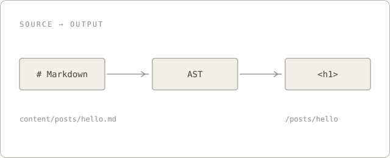

正文里的表格适合放精确数字，但有些东西用表格表达不出来：一列数值的大小关系、一屏就能读完的几个关键指标、
一张说明数据怎么流动的示意图。这篇笔记把这三类组件各写一遍，顺便当作模板的自测。

## 图片

图片放在 `content/images/`，正文里写相对于文章文件的路径，构建时会换成可以直接访问的地址：



图会带一圈细边线，宽度自适应，手机上不会溢出。

## 数据表

`data` 代码块的第一行是表头，其余每行是一条记录。`bars` 指定哪几列画横条，横条从 0 开始，
负数换一种颜色；`mark` 用来强调某一行：

```data title="构建耗时" bars="首次,增量" mark="冷启动" note="单位：秒。三次取中位数，本机测量。"
阶段 | 首次 | 增量
冷启动 | 48.2 | 12.4
热更新 | 6.1 | 0.8
静态导出 | 52.7 | 41.2
```

表格里的数字会自动右对齐，单元格里的第一个数字决定横条长度，所以 `48.2s`、`+12%`、`$1,200` 都能识别。

## 指标卡

`stats` 用 `##` 分组，每组下面是「标签 | 数值 | 说明」。以 `+` 开头的数值会用强调色：

```stats title="模板的体积" meta="生产构建" note="gzip 后的大小，不含图片。"
## 首屏
HTML | 14 KB | 单篇文章
CSS | 21 KB | 含 ak-ui
JS | 96 KB | 含搜索与主题

## 按需加载
图表库 | 382 KB | 只有出现图表时才加载
语法高亮 | 0 KB | 构建时完成
```

## 示意图

需要讲清楚一个结构时，直接写 SVG。`sketch` 提供了几个 class：`panel` 是底板，`node` 是节点，
`edge` 是连线，`caps` 是小号大写标题，`mid` 让文字居中：

```sketch title="一篇文章的三个阶段" note="示意，不是实测耗时。"
<svg viewBox="0 0 704 150">
  <rect class="panel" x="0" y="0" width="704" height="150" rx="10"/>
  <text class="caps" x="24" y="30">RENDER</text>
  <g class="node plain"><rect x="24" y="56" width="150" height="40" rx="4"/><text class="mid" x="99" y="76">Markdown</text></g>
  <path class="edge" d="M178 76 H218" marker-end="url(#arrow)"/>
  <g class="node blue"><rect x="222" y="56" width="190" height="40" rx="4"/><text class="mid" x="317" y="76">remark / rehype</text></g>
  <path class="edge" d="M416 76 H456" marker-end="url(#arrow)"/>
  <g class="node teal"><rect x="460" y="56" width="220" height="40" rx="4"/><text class="mid" x="570" y="76">HTML 与 SVG</text></g>
  <text class="small" x="24" y="124">源文件</text>
  <text class="small" x="460" y="124">静态产物</text>
</svg>
```

`sketch` 里的颜色只能写 class 或者 `var(--…)`，写死的颜色会被丢掉；`<script>`、`<style>`、
`foreignObject` 和事件属性也会在构建时被清掉。

## 交互图

需要悬停、动画或者图例的时候用 `echarts`，正文是一段合法的 JSON option：

```echarts title="每周的写作时间" note="小时；示意数据。" height="280"
{
  "tooltip": {"trigger": "axis"},
  "grid": {"left": 36, "right": 16, "top": 20, "bottom": 28},
  "xAxis": {"type": "category", "data": ["第一周", "第二周", "第三周", "第四周"]},
  "yAxis": {"type": "value"},
  "series": [
    {"name": "写作", "type": "bar", "barWidth": "36%", "data": [6, 9, 4, 11]},
    {"name": "修改", "type": "line", "smooth": true, "data": [2, 3, 1, 5]}
  ]
}
```

ECharts 只在页面里真的出现图表时才会加载，所以不放图表的文章不会为它付出体积。

## 小结

三类组件加起来覆盖了技术笔记里绝大多数「用文字说不清」的场合：精确数字用 `data`，关键指标用 `stats`，
结构用 `sketch`，需要交互时用 `echarts`。写错了不要紧——构建会指出文件和原因。
