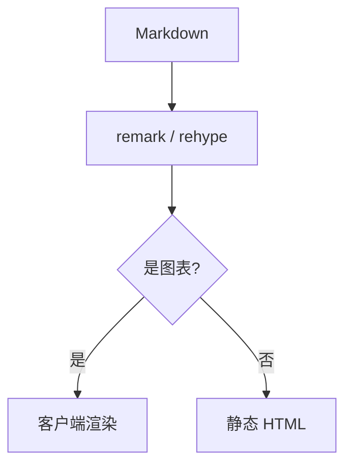

模板已经跑起来了，剩下的事情只有一件：把文章放进去。文章是 `content/posts/` 下的 Markdown 文件，
文件名就是网址（`content/posts/hello.md` → `/posts/hello`），同名的文件放在 `content/posts/en/`
下面就是同一篇文章的英文版。

## 元数据

文件开头是一段 YAML，之后空一行接正文：

```yaml
---
title: 从零写一篇笔记
description: 一句话摘要，会出现在列表、RSS 和搜索结果里。
date: 2026-01-08
updated: 2026-01-12
category: 折腾
tags:
  - Next.js
  - Markdown
---
```

| 字段 | 必填 | 说明 |
| --- | --- | --- |
| `title` | 是 | 页面标题，正文里不要再写一遍 `# 标题` |
| `description` | 是 | 列表页和 meta description 用的摘要 |
| `date` | 是 | `YYYY-MM-DD` |
| `updated` | 否 | 实质修改的日期 |
| `category` | 否 | 分类，生成一个归档页 |
| `tags` | 否 | 标签列表，每个标签也有自己的归档页 |
| `draft` | 否 | `true` 时不进入正式构建 |

少了必填字段，或者日期写成 `2026/01/08`，构建会直接失败并指出是哪个文件。

## 正文

正文从 `##` 开始——`##` 和 `###` 会自动进目录，标题里的中文原样保留。
表格、引用、列表、删除线、任务列表都是标准的 GFM 写法：

- 列表项
- 第二项
  - 嵌套项

行内公式写作 $e^{i\pi} + 1 = 0$，独立公式单独占一行：

$$
\int_{-\infty}^{\infty} e^{-x^2}\,\mathrm{d}x = \sqrt{\pi}
$$

## 代码

代码块标注语言就会高亮，角上会显示语言名和复制按钮；加 `title` 会显示文件路径：

```ts title="src/lib/posts.ts"
export async function getPosts(locale: Locale): Promise<Post[]> {
  const posts = await getAllPosts()
  return posts.filter((post) => post.locale === locale && !post.draft)
}
```

> 引用别人的代码时，把永久链接写进 `src`，读者就能跳到确切的行。

## 图与表

需要精确数字就用 `data`，需要一屏的关键数字就用 `stats`：

```stats title="构建耗时" meta="本地 · M2" note="三次取中位数。"
## 冷启动
首次编译 | 2.4 s | 含依赖预构建
热更新 | 180 ms | 单文件改动
```

流程和结构交给 Mermaid：



## 小结

写完存盘，刷新页面就能看到。发布时先跑 `npm run build`，再用 `npm start` 启动 Node 服务；代理、动态 404 和图片路由都需要运行时，不能把 `.next` 直接交给纯静态托管。