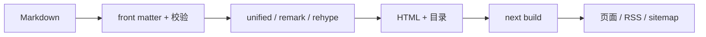
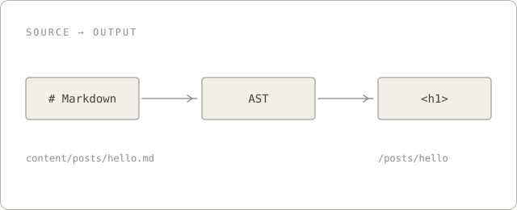

SwufeFox 是西南财经大学的学生开源社区。我们写代码、做量化，也把学到的东西开源。这个博客是社区的门面，也是我们第一次把「怎么搭一套自己的工具」完整写下来。

第一次看到 mizore 的博客时，我记住的不是某一篇文章，而是它把「读」做成了一种界面：纸面、细线、深色的标题块，像一份被反复翻阅的档案。后来我们决定用 Next.js 和 ak-ui 重做它，但不是复刻一个更漂亮的外壳，而是把它变成一套可以长期维护、也可以交给别人使用的博客模板。

这篇笔记记录的就是那套模板的几个关键决定，以及我们最后没有做的事情。

## 内容先于页面

模板没有数据库，也没有后台。每篇文章就是 `content/posts/` 下的一个 Markdown 文件，文件名就是 slug。构建时，`gray-matter` 读 front matter，剩下的交给 `unified`：

```yaml
---
title: 把博客做成一台档案终端
date: 2026-11-12
category: 建站
tags: [Next.js, ak-ui]
---
```

`title`、`description` 和 `YYYY-MM-DD` 格式的 `date` 是必填的；`tags` 必须是列表；`category` 可以省略。任何一项写错，`next build` 都会停下来，并把出错的文件名写进错误信息。对个人博客来说，这比在运行时悄悄跳过一篇文章更可靠。





图片、代码高亮、公式、数据表、Mermaid、手写 SVG 和 ECharts 都在同一条管线里。图片会读取本地宽高并加上 `loading="lazy"`，正文不会在图片下载完之后突然跳动。

## 两种语言，一个地址

中文在根路径，英文在 `/en`。同一篇文章在 `content/posts/en/` 下放一个同名文件，就自动成为翻译；没有翻译时，文章仍然只出现在中文里。

默认语言的路由由 `next.config.ts` 的重写放进 `/zh`，再由 `src/proxy.ts` 把 `/zh/...` 308 回根路径。这样 `/posts/hello` 是唯一地址，不会出现两套 canonical。代理、动态 404 和 `/content/images/` 图片路由都需要 Node 运行时，所以默认部署方式是 `next start`，而不是把 `.next` 直接丢给静态托管。

## 设计语言不是一层皮肤

模板使用 ak-ui 的 `accent` 强度：保留博客的阅读布局，只借用它的排版、信号色、紧凑元数据和一处克制的切角。黑、白、灰承担结构；动作黄只出现在真实状态上——当前导航、标签信号、搜索命中、阅读进度和目录当前项；错误页才使用危险红。SwufeFox 的海军蓝、金色和狐狸标记只出现在品牌层：Hero、页头标记和分享卡片，它们不替代 ak-ui 的语义色。

首页只有一个深色焦点：海军蓝的 Hero，左侧是 SWUFEFOX 与社区说明，右侧是狐狸标记，右下角切掉 24px。除此之外，页面是平的：没有悬浮阴影，没有一排相同的圆角卡片，也没有为了「像游戏」而添加的假数字。

```data title="四个决定" note="先定内容，再定界面。"
选择 | 结果
构建时定稿 | 页面、RSS、sitemap 在 next build 生成
根路径中文 | 英文在 /en，同名 Markdown 互为翻译
海军蓝 Hero + 狐狸标记 | 全站只有一个视觉焦点
墨色结构 | 动作黄只留给状态与反馈
```

文章页把目录收成一条平直侧栏：没有面板底色和边框，只留左侧墨色条与当前项的黄色标记。正文的第一个段落略微放大，作为进入文章的语气。归档页则换成 `AkTable`：类型、名称、文章数，三列足够，不需要一段又一段的大标题。

## 交互的秩序

真正让人愿意继续用的，往往不是动画，而是状态是否诚实。

- 搜索词同步到 `?q=`。刷新、分享和从别的页面返回都能恢复，输入过程不会污染浏览器历史。
- 目录的高亮由滚动位置计算，而不是等某个标题恰好进入观察带；两节之间不会突然空白。
- 主题开关同时渲染两套图标和文案，由 `[data-ak-theme]` 切换，首帧不会闪出错误的一侧；`theme-color` 也跟着变。
- 复制、Mermaid 和 ECharts 按需加载；没有图表的文章不会下载这两个库。
- 主题、导航和菜单保持 44px 的操作面积，次级链接至少 24px；键盘焦点不被裁切。

分享卡片也是同一套语言：`/og` 输出 1200×630 的海军蓝底、奶油色狐狸面板和大字 `SWUFEFOX`，所有页面共用；中文留在页面和 description 里，因为默认字体只覆盖拉丁字符。

## 我们刻意没有做的事

ak-ui 还提供了 `AkScreen`、`AkCommandGrid`、干员卡、关卡和稀有度等游戏数据组件，以及粒子、深度和扫描线。它们很适合组件目录，但不适合一个读文章的地方。

模板没有用它们。没有假遥测，没有让每个元素都切角、编号或大写，也没有为了「有设计感」而牺牲阅读。设计系统的边界感，比把所有组件都摆上来更重要。

## 收尾

现在这套模板有构建时的内容校验、双语的静态路由、可分享的搜索、连续的目录高亮、深浅主题和一张自己的分享卡片。它仍然是一个博客，不是一个控制台。

这篇文章本身就是一次验收：它与之后所有文章走同一条 front matter、图片和 Markdown 管线。如果它能在这里安静地出现，模板就算准备好了。

The final variable is yours to change. 最后一个变量留给人来改。

— Magixyne，2026-11-12
