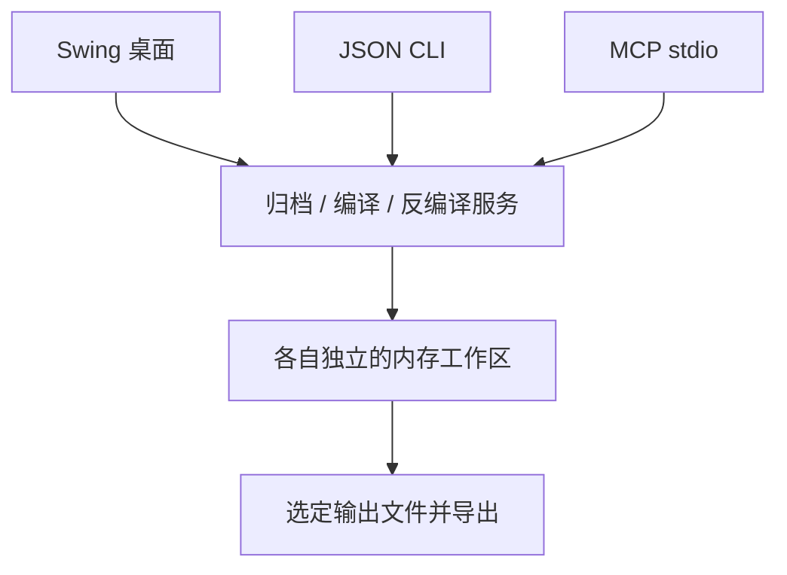
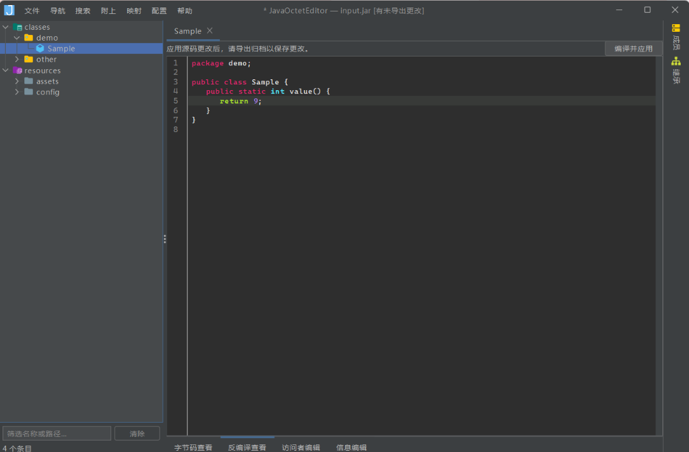

我们开始接手 JavaOctetEditor 的后续维护了。它是一个 Java 字节码编辑器，原项目来自 [Enaium](https://github.com/Enaium/JavaOctetEditor)，现在的维护仓库放在 [SwufeFox/JavaOctetEditor](https://github.com/SwufeFox/JavaOctetEditor)。原作者的署名和 Apache 2.0 许可继续保留。

这个工具已经有很好的基础：打开 JAR，浏览类与资源，反编译源码，检查和编辑字节码，做名称映射与转换。对需要排查 Java 依赖、理解已有程序或研究 class 文件的人来说，这些功能仍然有直接价值。我们这轮的工作，是把这些能力之间的状态和边界整理清楚，让人和程序都能更可靠地使用它。

## 先守住归档的边界

一个 JAR 里面既有 class，也有资源、目录和元数据。编辑其中一个类，不能顺手丢掉别的内容；编译产生一组新 class，也不能只成功替换其中一半。维护这种工具，首先要把「读入、修改、提交、导出」各自负责什么说清楚。

现在，修改保留在内存里，导出才写入选定的文件。归档读写集中到 `ArchiveIO`；后台编译、映射和导出使用由模型所属线程捕获的 `ArchiveSnapshot`，处理独立的数据。源码编译通过 `ArchiveCompilation` 准备完整输出，检查原归档与取消状态后，再一次性提交。

这样，编译失败会保留原有字节码；任务运行期间发生了冲突，旧结果会被拒绝；导出对应捕获时的内容，期间出现的新修改仍然标记为尚未导出。耗时工作放在后台，Swing 界面的模型发布留在 EDT 上。

兼容性也需要具体规则。修改已有类时使用它原来的 Java 目标版本，当前 JDK 无法支持时明确失败。多版本 JAR 中的版本化 class 继续作为资源保留。重新编译后的内部类清理依据字节码的所属信息，名字里带一个 `$` 并不足以证明它属于某个外部类。

这些细节不太适合放在产品首页上，但会决定一个编辑结果能不能继续使用。

## 三个入口，使用同一套服务

这轮重构之后，Swing 桌面、JSON CLI 和 MCP stdio 服务使用同一套归档、编译与反编译能力。共享服务可以在没有桌面单例、没有显示服务器的环境中工作。



CLI 的标准输出只放 JSON，MCP 的标准输出只放协议消息，诊断信息走标准错误。工具目录提供 JSON Schema，调用方可以发现参数与操作，而不必先翻实现代码。类、资源和搜索结果都有分页，归档句柄也有明确的生命周期。

MCP 的编辑流程尤其需要守住版本边界：先用 `open_archive` 获得 `archiveId` 与 `revision`，检查或反编译目标，再带着当前 `expectedRevision` 提交修改。修订不匹配就拒绝写入，调用方重新检查。检查结果之后，还要明确调用导出操作。

这与前一篇 [Agent over tools：把工具做成协议](/posts/agent-over-tools) 讨论的是同一种接口纪律：让工具说明输入、结果和失败，让 agent 在这些边界之上做决策。JavaOctetEditor 的源码编译不会运行归档里的类；归档内容仍然是需要检查的数据。

下面两个命令分别展示一次查找和 MCP 服务入口。这里假设完整构建文件名为 `JavaOctetEditor.jar`，`application.jar` 是待检查的归档：

```sh title="命令行与 MCP 入口"
java -jar JavaOctetEditor.jar --cli find_entries --archive application.jar
java -jar JavaOctetEditor.jar --mcp
```

## 编辑状态要看得见

桌面端最容易让人困惑的，是「我按了保存，现在到底保存到哪里了」。这次我们把三种状态分别表达出来：

1. **草稿**：编辑器里的文本发生了变化，还没有应用到归档。
2. **已应用**：编译或资源修改已经进入内存模型，原始文件保持不变。
3. **已导出**：选定的归档内容已经写入输出文件；之后的新修改仍需处理。

源码、Visitor 和文本资源都有草稿跟踪。关闭标签页时可以选择应用、放弃或取消；打开其他归档和关闭窗口时，还会检查尚未导出的归档修改。后台刷新保留脏缓冲区，编译期间继续输入的新内容也保留为草稿。

文件选择器里的「取消」同样需要兑现。用户曾经点选一个路径，不代表后来取消对话框时还授权写入那个路径。这个判断现在与草稿、归档版本和后台任务的发布检查一起，成为实际操作的一部分。



日常操作也补了一些直接的便利：`Ctrl+P` 可以按类名、缩写或资源路径快速打开文件，树筛选输入即生效；再次打开同一个条目会选中已有标签。资源可以导入、替换、删除，也能和单个 class 一样原样导出。文本、图片与二进制内容使用各自合适的视图。

这些改动让使用者更容易知道当前正在看什么、改了什么，以及哪些操作还没有完成。

## 把 smoke 留在仓库里

接手后的验证不能只依赖维护者记得点过哪些按钮。我们把可重复运行的桌面 smoke 源码放进了 `src/smoke/java/`，用独立的 Gradle 任务启动打包后的应用：

```sh title="回归测试与真实桌面验证"
./gradlew build
./gradlew desktopSmoke
```

截至这次记录，本地构建中的 **171 项回归测试通过**，打包后的 CLI、MCP 调用和进程退出也经过检查。Windows 图形会话中的桌面 smoke 则实际覆盖了载入归档、源码编译、Java 8 目标版本保留、编译期间的新草稿、键盘导航、资源增删改、单文件导出、取消导出以及关闭取消。

smoke 会读回导出的 class 和资源，检查结果里的实际内容。比如编译捕获的是一份源码，编辑器随后又出现了新输入，就要同时确认：应用的是捕获时的版本，新输入仍然留在编辑器中。

默认 `test` 和 `build` 保持无界面，`desktopSmoke` 需要图形会话。每次运行都在忽略的 `build/desktop-smoke/` 下建立独立目录，隔离设置、输入、导出文件和截图。源码随版本管理，临时产物留在构建目录里。

这些结果描述的是本轮检查。后续遇到具体兼容性问题时，还需要把可复现的输入和预期补进验证路径。

## 给后续维护留下入口

仓库里的 `AGENTS.md` 记录架构、运行命令和关键约束，方便下一位维护者或 coding agent 接着工作。Dependabot 负责按周提出 Gradle 与 GitHub Actions 的版本更新，小版本与补丁分组，主版本单独审查。

我们也加了一个轻量的[产品介绍页](https://github.com/SwufeFox/JavaOctetEditor/tree/133f9e2/site)，集中说明桌面、CLI、MCP 和构建获取方式。页面里的交互归档明确标注为示例，桌面截图来自实际验证。这一页随仓库保存在 `site/`，使用原生 HTML、CSS 和 JavaScript。

维护记录、可执行的检查和实际入口都留在项目里，之后的工作就能从一个具体问题继续，而不用先复原这一轮对话。

## 从这里开始使用

当前项目使用完整 **JDK 21**。可以从[快照构建记录](https://github.com/SwufeFox/JavaOctetEditor/actions/workflows/build_snapshot.yml)获取包含依赖的 JAR；下载 GitHub Actions 产物需要登录 GitHub。也可以直接从源码运行：

```sh title="从源码构建"
git clone https://github.com/SwufeFox/JavaOctetEditor.git
cd JavaOctetEditor
./gradlew build
./gradlew run
```

Windows 下使用相应的 `.\gradlew.bat` 命令。CLI 参数文件、MCP 客户端配置和导出选项都在[项目 README](https://github.com/SwufeFox/JavaOctetEditor/blob/master/README.md)里。

如果你正好在处理某个难以理解的 class、某种目标版本兼容性，或一段需要批量修改的 Java 归档流程，欢迎带着可复现的案例来提 Issue 或 PR。我们会从这些具体输入继续把 JavaOctetEditor 做好。

— Magixyne，2026-11-14
