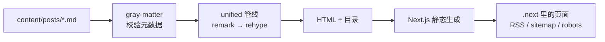

# 它是怎么工作的

一句话：文章在构建时变成 HTML 字符串，页面是普通的 React 服务端组件，浏览器只负责三件事——
主题、搜索过滤、图表渲染。

## 路由

| 地址 | 文件 | 说明 |
| --- | --- | --- |
| `/`、`/en` | `src/app/[locale]/page.tsx` | 首页：简介、分类、文章列表 |
| `/posts/<slug>` | `src/app/[locale]/posts/[slug]/page.tsx` | 文章页：目录、正文、附记、上一篇 / 下一篇 |
| `/tags` | `src/app/[locale]/tags/page.tsx` | 分类与标签总览 |
| `/tags/<term>` | `src/app/[locale]/tags/[tag]/page.tsx` | 某个分类或标签下的文章 |
| `/search` | `src/app/[locale]/search/page.tsx` | 搜索（`noindex`） |
| `/feed.xml` | `src/app/[locale]/feed.xml/route.ts` | 每个语言一份 RSS |
| `/sitemap.xml`、`/robots.txt` | `src/app/sitemap.ts`、`src/app/robots.ts` | 自动生成 |
| `/content/images/…` | `scripts/export-static.mjs` + `public/_headers` | 正文图片，构建时复制进 `out/` |
| `/og` | `src/app/og/route.tsx` | 1200×630 社交卡片，`ImageResponse` 生成 |
| 404 | `public/404.html` | Cloudflare Pages 的静态 404 |

这个仓库以 `output: 'export'` 构建到 `out/`；没有运行时路由。默认语言在开发时仍由 `next.config.ts`
的 `beforeFiles` 重写到 `/zh`。生产构建由 `scripts/export-static.mjs` 把 `out/zh` 复制到根路径，
`public/_redirects` 把 `/zh/…` 301 回根，避免同一页有两个地址；`content/images` 也在同一脚本里复制成
`out/content/images`。

`src/lib/urls.ts` 负责生成规范地址：默认语言不带前缀，其他语言带。canonical、hreflang、
RSS 的链接都用它。文章、归档、标签和搜索页各自在 `generateMetadata` 里声明自己的
`alternates.canonical` 与 `languages`；首页由 layout 的 canonical 负责，新增路由时不要依赖它。

`src/lib/social.ts` 提供同一张 1200×630 社交卡片（`/og`），layout 与文章 metadata 都把它挂到
`openGraph.images` 和 `twitter.images`；Twitter 使用 `summary_large_image`。

## 内容层

`src/lib/posts.ts`：

- 扫描 `content/posts/*.md`（默认语言）和 `content/posts/<locale>/*.md`，目录名必须是
  `locales` 里的语言，否则跳过。
- `gray-matter` 解析 YAML；缺字段、日期格式、`tags` 类型、YAML 语法错误都会抛错，
  错误信息里带文件名。
- 结果缓存在模块级变量里，一次构建只读一遍磁盘。
- 阅读时间按「中日韩字符数 + 英文词数」估算，所以中英混排不会偏五倍。
- `draft: true` 的文章在 `getPosts()` 里被过滤；`getPost()` 走同一个函数，所以草稿网址是 404。

## Markdown 管线

`src/lib/markdown.ts` 的 `createProcessor` 按固定顺序串起来：

| 步骤 | 作用 |
| --- | --- |
| `remarkParse` / `remarkGfm` / `remarkMath` | 解析 Markdown、表格、任务列表、`$…$` |
| `remarkStripHtml` | 丢掉正文里的原始 HTML |
| `remarkRenderMath` | 用 KaTeX 渲染公式，输出 HTML + MathML |
| `remarkBlogBlocks` | 把 `data` / `stats` / `mermaid` / `sketch` / `echarts` 代码块换成自带标记的 HTML |
| `remarkRehype` | mdast → hast，保留原始 HTML 节点 |
| `rehypeRaw` | 把上一步生成的 HTML 解析成真正的节点 |
| `rehypeSlug` | 给 `h2` / `h3` 生成锚点 id |
| `rehypeMediaPaths` | 相对图片路径 → `/content/…`；本地图片补 `width` / `height`、`loading="lazy"`、`decoding="async"` |
| `rehypePrettyCode` | Shiki 高亮，明暗双主题，行号，行内注释 |
| `rehypeCodeFigure` | 给代码块加顶栏：文件路径、语言、源码链接、复制按钮 |
| `rehypeAutolinkHeadings` | 标题后的 `#` 链接 |
| `rehypeStringify` | 输出 HTML |

几个容易踩的点：

- **原始 HTML 必须先清掉。** `rehypeRaw` 会把所有 raw 节点解析成 DOM，所以正文里的 `<script>`
  在到达它之前就被 `remarkStripHtml` 删掉了；之后出现的 raw 节点全是管线自己生成的。
- **`rehypeStringify` 要开 `allowDangerousHtml`。** `rehypeCodeFigure` 在 `rehypeRaw` 之后才插入
  `<figcaption>`，那是 raw 节点，字符串化时必须原样放行，否则会被转义成文本。
- **自定义代码块走 HTML 字符串，不写 hast。** 五类块在 remark 阶段拼成字符串，交给 `rehypeRaw`
  解析；这样 `sketch` 里的手写 SVG 也能正确进入 SVG 命名空间。
- **目录不是插件。** 所有转换跑完后遍历一遍 hast，收集带 id 的 `h2` / `h3`，得到 `TocEntry[]`。
  收集标题时会跳过 `rehype-autolink-headings` 追加的 `#` 锚点，所以目录文字不带尾随井号。

目录列表、代码顶栏、图表容器的 HTML 都是服务端渲染的；Mermaid / ECharts 的图形内容、阅读进度条
和目录的当前小节高亮由浏览器补上。没有图表的文章不会下载这两个图库。

## 阅读进度与目录高亮

`src/components/reading-progress.tsx` 在文章页顶部渲染一条 3px 的 sticky 进度条，按
`scrollY / (scrollHeight - innerHeight)` 填充。

`src/components/post-toc.tsx` 是客户端组件，但 `<ol>` 仍由服务端渲染。滚动时用
`requestAnimationFrame` 取视口上方 25% 之前的最后一个 `h2`/`h3`，给对应链接加
`aria-current="location"`；到文档底部固定最后一节。这样两节之间不会出现高亮空白。
样式把它画成左侧的动作黄竖线。点击目录项会立即更新高亮，随后交还给滚动计算。

## 浏览器运行时

`src/components/post-runtime.tsx` 是文章正文里唯一的交互脚本，做三件事：

1. **复制按钮**：事件委托，找到按钮所在的 `figure` 里的 `pre code`，写入剪贴板并改文案。
2. **Mermaid**：把 `[data-ak-figure="mermaid"]` 里的 JSON 源码交给 Mermaid，渲染成 SVG 替换进去。
3. **ECharts**：同理，把 option 交给 ECharts（SVG 渲染器）；没有写 `color` 时注入主题配色。

两个库都是 `await import()` 的：文章里没有对应图表就永远不会下载。`sketch` 完全不需要脚本，
它在构建时就是内联 SVG。

## ak-ui 的客户端边界

`@swufefox/ak-ui-react` 2.0 的入口带有 `"use client"`。Next.js 服务端组件可以直接导入和组合这些组件；它们仍会生成首屏 HTML，再由浏览器 hydration。样式表只需在 `src/app/[locale]/layout.tsx` 导入一次，不再需要 `src/components/ak.ts` 转发层。

`AkMobileMenu` 的实例 ID 仍由模块级计数器生成。`src/components/site-nav.tsx` 用 `useSyncExternalStore` 将它延迟到 hydration 后挂载，避免服务端与浏览器的计数不同导致 ID 不匹配。

## 搜索

没有后端，也没有单独的索引文件：搜索页在服务端把当前语言的文章压成
`{ slug, title, description, tags, category, date }` 交给 `SearchClient`。浏览器按每个查询词独立计分：
标题 4 分、标签 / 分类 2 分、摘要 1 分；命中至少一个词的文章按总分排序，命中的词包进 `<mark>`。
输入框是受控的，状态变化即时过滤，不需要提交。查询词同步到 `?q=`（`history.replaceState`），
直接分享、刷新或从别的页面返回时都能恢复；清空输入会移除这个参数。

文章多到十万字以上时可以把这套换成 `search.json` + 预建索引，接口在
`src/components/search-client.tsx` 的 `items` 上。

## 想改点什么

| 想做的事 | 改哪里 |
| --- | --- |
| 加一种自定义代码块 | `src/lib/markdown.ts`：`BLOCK_LANGUAGES` 加语言，`remarkBlogBlocks` 里加分支 |
| 加一个页面 | `src/app/[locale]/` 下新建 `page.tsx`，地址用 `src/lib/urls.ts` 生成 |
| 换 Markdown 主题色 | `rehypePrettyCode` 的 `theme` 换成别的 Shiki 主题 |
| 改正文排版 | `src/styles/globals.css` 的 `.prose` 段 |
| 加页脚链接 | `site.config.ts` 的 `sameAs` / `email` |
| 加 RSS 字段 | `src/app/[locale]/feed.xml/route.ts` |
