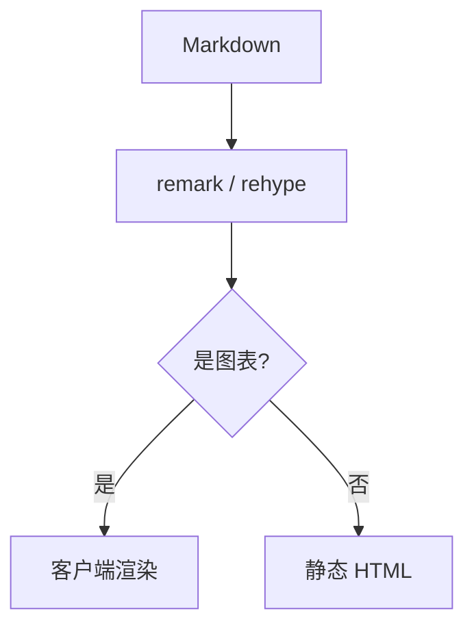

# 写文章

一篇文章就是一个 Markdown 文件。文件名是 slug，也就是网址：

```
content/posts/hello.md      → /posts/hello
content/posts/en/hello.md   → /en/posts/hello
```

`content/posts/` 根目录的文件属于默认语言（`src/site.config.ts` 里的 `defaultLocale`），
`content/posts/en/` 里的属于英文。两个目录下同名的文件互为翻译，文章页会自动显示切换链接。

文件名只影响网址，标题、摘要这些都在文件的元数据里。

## 元数据

正文之前是一段 YAML，`---` 包住：

```yaml
---
title: 从零写一篇笔记
description: 一句话摘要，列表页、RSS 和 meta description 都用它。
date: 2026-01-08
updated: 2026-01-12      # 可选
category: 折腾            # 可选，生成一个归档页
tags: [Next.js, Markdown] # 可选
draft: false             # 可选
---
```

| 字段 | 必填 | 说明 |
| --- | --- | --- |
| `title` | 是 | 页面 h1，正文里不要再写一遍 `# 标题` |
| `description` | 是 | 首页列表、RSS 和 meta description |
| `date` | 是 | `YYYY-MM-DD` |
| `updated` | 否 | 实质修改的日期 |
| `category` | 否 | 只有一个，生成 `/tags/<名字>` 归档页 |
| `tags` | 否 | 标签列表，每个标签也有归档页 |
| `draft` | 否 | `true` 时不进入正式构建；`next dev` 里仍然可见 |

`tag` 是 `category` 的旧写法，从 Go 版博客迁移过来的文章可以直接用。

元数据写错时构建会失败，报错里带文件名和原因：缺字段、日期格式不对、`tags` 不是列表，
或者 YAML 本身有语法错误（摘要里有 `: ` 时要加引号）。

## 正文

正文从 `##` 开始。`##` 和 `###` 会自动获得锚点并进入右侧目录，中文原样保留：

```markdown
## 问题一：屏幕花屏
```

会得到 `#问题一屏幕花屏`。

支持 GFM：表格、引用、有序 / 无序列表、任务列表、删除线、自动链接。
原始 HTML 会被丢弃（这也是 `<script>` 进不来的原因），需要结构就用手写 SVG 或 Mermaid。

行内代码用反引号，独立代码块用三个反引号并标语言。

## 代码

````markdown
```ts title="src/lib/posts.ts"
export async function getPosts(locale: Locale) {
  return (await getAllPosts()).filter((post) => post.locale === locale)
}
```
````

| 写法 | 效果 |
| --- | --- |
| ` ```ts ` | 高亮、行号、语言标签、复制按钮 |
| ` ```ts title="src/a.ts" ` | 额外在顶栏显示文件路径 |
| ` ```ts src="https://github.com/…/blob/<commit>/a.ts#L10-L24" ` | 顶栏加一个 `source ↗` 链接，建议用带 commit 的永久链接 |
| ` ``` ` | 不标语言时按纯文本处理 |

高亮在构建时用 Shiki 完成，颜色有明暗两套，跟着主题切换。

## 公式

行内写 `$e^{i\pi} + 1 = 0$`，独立公式让 `$$` 各占一行：

```markdown
$$
\int_{-\infty}^{\infty} e^{-x^2}\,\mathrm{d}x = \sqrt{\pi}
$$
```

构建时用 KaTeX 渲染，输出 HTML + MathML，正文不依赖 JavaScript。公式写错会让构建失败并指出
是哪一段。需要字面量 `$` 时写 `\$`。

## 图片

图片放在 `content/images/`，正文里写相对于 Markdown 文件的路径：

```markdown

```

构建时会把相对路径改写成 `/content/images/…`，由 `src/app/content/[...path]` 提供。本地图片还会被读一次尺寸，写成 `width` / `height` 属性，并带上 `loading="lazy"` 和 `decoding="async"`，避免图片加载完成后把正文顶下去。
路由只服务 `content/images/` 下的图片（PNG、JPEG、WebP、GIF、AVIF、SVG），不会公开文章源文件，
并带一年长的缓存头。也可以直接写 `/content/images/…` 或外链 `https://…`。

图片宽度自适应正文栏，带一圈细边线；手机上不会溢出。

## 数据表 `data`

需要精确数字、并且想让人一眼看出大小关系时用它。第一行是表头，其余每行一条记录：

````markdown
```data title="构建耗时" bars="首次,增量" mark="冷启动" note="单位：秒，三次取中位数。"
阶段 | 首次 | 增量
冷启动 | 48.2 | 12.4
热更新 | 6.1 | 0.8
静态导出 | 52.7 | 41.2
```
````

| 属性 | 说明 |
| --- | --- |
| `title` | 表格标题，也会成为图注 |
| `note` | 表下的注释 |
| `bars` | 画横条的列名，逗号分隔 |
| `scale` | `shared`（默认，所有横条共用一个比例）或 `column`（每列各自缩放） |
| `mark` | 强调的行，按第一列的值匹配，逗号分隔 |

单元格里的第一个数字决定横条长度，`48.2s`、`+12%`、`$1,200`、`−3.4%` 都能识别；
负数用另一种颜色。整列都是数字时自动右对齐。

## 指标卡 `stats`

一屏就能读完的几个关键数字：

````markdown
```stats title="模板的体积" meta="生产构建" note="gzip 后的大小，不含图片。"
## 首屏
HTML | 14 KB | 单篇文章
CSS | 21 KB | 含 ak-ui

## 按需加载
图表库 | 382 KB | 只有出现图表时才加载
```
````

`##` 开始一组；每组下面是 `标签 | 数值 | 说明`，说明可以省略。以 `+` 开头的数值会用强调色。
属性：`title`、`meta`（标题右侧的小字）、`note`。

## Mermaid

流程、分支、时序、状态机交给 Mermaid，不要在正文里画 ASCII 框线：

````markdown

````

属性：`title`、`note`。图在浏览器里用 Mermaid 渲染成 SVG，只有文章里真的出现 `mermaid`
代码块时才会加载这个库。语法错误会在浏览器控制台里报出来，正文保留源码作为回退。

## 示意图 `sketch`

要讲清楚一个结构（并排对比、按比例的组成、嵌套的边界），直接写 SVG：

````markdown
```sketch title="一篇文章的三个阶段" note="示意，不是实测耗时。"
<svg viewBox="0 0 704 150">
  <rect class="panel" x="0" y="0" width="704" height="150" rx="10"/>
  <text class="caps" x="24" y="30">RENDER</text>
  <g class="node plain"><rect x="24" y="56" width="150" height="40" rx="4"/><text class="mid" x="99" y="76">Markdown</text></g>
  <path class="edge" d="M178 76 H218" marker-end="url(#arrow)"/>
  <g class="node blue"><rect x="222" y="56" width="190" height="40" rx="4"/><text class="mid" x="317" y="76">remark / rehype</text></g>
  <path class="edge" d="M416 76 H456" marker-end="url(#arrow)"/>
  <g class="node teal"><rect x="460" y="56" width="220" height="40" rx="4"/><text class="mid" x="570" y="76">HTML 与 SVG</text></g>
</svg>
```
````

画布宽度一般就是正文栏的 704，高度按内容定；`<svg>` 上不写 `width` / `height` / `class`。

| class | 用在 | 样子 |
| --- | --- | --- |
| `panel` | 背景 `rect` | 暖灰底板，不描边 |
| `window` | `rect` | 虚线圆角框：上下文窗口、沙箱、一组东西的边界 |
| `node` | 包住 `rect` + `text` 的 `g` | 暖灰填充、深灰细描边的节点 |
| `node plain` | 同上 | 白底 |
| `node blue` / `teal` / `orange` / `violet` / `clay` | 同上 | 按角色上色，文字同步换色 |
| `edge` / `edge dash` / `edge hot` | `path` / `line` | 1.25px 连线；虚线=可选，clay=出问题的地方 |
| `caps` | `text` | 等宽小号、自动大写，用作板块标题 |
| `small` | `text` | 11px 灰色说明 |
| `b` / `mono` | `text` | 加粗 / 等宽 |
| `mid` / `end` | `text` | 居中 / 右对齐 |

颜色只能写 class 或 `var(--…)`；写死的颜色、`<script>`、`<style>`、`<foreignObject>`、
`style` 属性和事件属性都会在构建时被清掉。连线写 `marker-end="url(#arrow)"` 会自动补上开口箭头；
需要精确坐标时先在纸上算好网格（行高 34、节点间距 4–24），再照着写。

## 交互图表 `echarts`

需要悬停、动画、图例或者 Mermaid 画不了的图形时用。正文是一段合法的 ECharts option JSON：

````markdown
```echarts title="每周的写作时间" note="小时；示意数据。" height="280"
{
  "tooltip": {"trigger": "axis"},
  "grid": {"left": 36, "right": 16, "top": 20, "bottom": 28},
  "xAxis": {"type": "category", "data": ["第一周", "第二周", "第三周", "第四周"]},
  "yAxis": {"type": "value"},
  "series": [
    {"name": "写作", "type": "bar", "barWidth": "36%", "data": [6, 9, 4, 11]},
    {"name": "修改", "type": "line", "smooth": true, "data": [2, 3, 1, 5]}
  ]
}
```
````

| 属性 | 说明 |
| --- | --- |
| `title` | 必填，图上方的标题 |
| `note` | 图下的注释：数据来源、时间范围、口径 |
| `height` | 像素，160–720，默认 360；宽度跟随正文 |

只有 JSON，不能写函数——`formatter` 用字符串模板，如 `"{value}%"`。没有写 `color` 时，
运行时会用主题调色板（clay / 绿 / 蓝 / 灰）填 `option.color`，深浅色都对；写了就按你的来。

ECharts 只在页面里出现图表时加载，没有图表的文章不会为它付出体积。

## 草稿与校验

`draft: true` 的文章不会进入 `next build` 的产物，但在 `next dev` 里可以正常预览。
文章目录里只认 `.md` 文件，其他后缀会被忽略。

构建失败时不会留下一个半成品：报错会指出是哪个文件、哪个字段或哪一段代码块。
